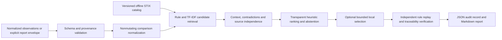

# Architecture

## Modules

| Module | Responsibility |
|---|---|
| `src/catalog/store.py` | Bounded JSON parsing, structural STIX profile validation, UUID/reference checks, version metadata, atomic import, offline query and original object preservation |
| `src/schemas/observations.py` | Schema 1.0, provenance statuses, timezone-aware timestamps, typed context, batch uniqueness and contextual reference validation |
| `src/ingestion/readers.py` | Normalized batches and explicit interoperable report envelopes; no vendor-specific guessing |
| `src/normalization/events.py` | Comparison-only process basename, command token, registry path and underlying-event keys |
| `src/rules` | Versioned rule definitions, handler/technique contracts and structured predicates |
| `src/candidate_generation/retrieval.py` | Local TF-IDF metadata retrieval; unverified candidates only |
| `src/evidence/assessment.py` | Directness, context gaps, failed outcomes, platform compatibility, contrary evidence and declared source independence |
| `src/ranking/scoring.py` | Configurable weighted factors, hard status gates and heuristic scores |
| `src/engine.py` | Pipeline orchestration, behavior-instance grouping, parent suppression and run metadata |
| `src/verification/results.py` | Independent rule replay, catalog metadata/evidence checks, score and status gates |
| `src/llm/ollama.py` | Local-only bounded structured selection with application-owned rationale templates |
| `src/reporting/reports.py` | JSON persistence, escaped Markdown, source references and uncertainty |
| `src/evaluation` | Explicit annotations, three configurations, set/ranking metrics and per-case outcomes |
| `src/main.py` | CLI and nonzero failure exit statuses |

## Storage and failures

Catalog imports build and validate everything before a same-directory temporary write plus atomic rename. Invalid imports preserve a working catalog. The raw object store retains all STIX objects, relationships, references and newer detection-strategy/analytic objects, even when the normalized technique index exposes only legacy detection/data-source text. This validates a documented structural ATT&CK profile, not every constraint in the complete STIX standard.

Enterprise is the initial indexed domain; domain metadata and preserved raw objects allow future domain-specific indexes. Historical revoked children may have missing parent relationships; they remain explicitly warned and are never active recommendations. Nonempty unresolved references fail imports. Empty optional MITRE custom reference fields are preserved as unavailable metadata.

Mapping performs no catalog updates or downloads. A run loads a single catalog snapshot, creates a metadata index, and records catalog/rule hashes and complete scoring configuration. Separate event instances remain separate mappings; explicit correlation IDs allow grouping. Copies of an underlying event cannot create independent-source bonuses.

Schema/catalog/rule errors fail with CLI exit status 2. Weak, insufficient and rejected candidates are valid audit outcomes rather than pipeline failures. Optional LLM failure adds a warning and keeps deterministic output. Reports use unique IDs and exclusive creation. No server is required; future tasks activate the retained virtual environment and operate from the existing checkout.
